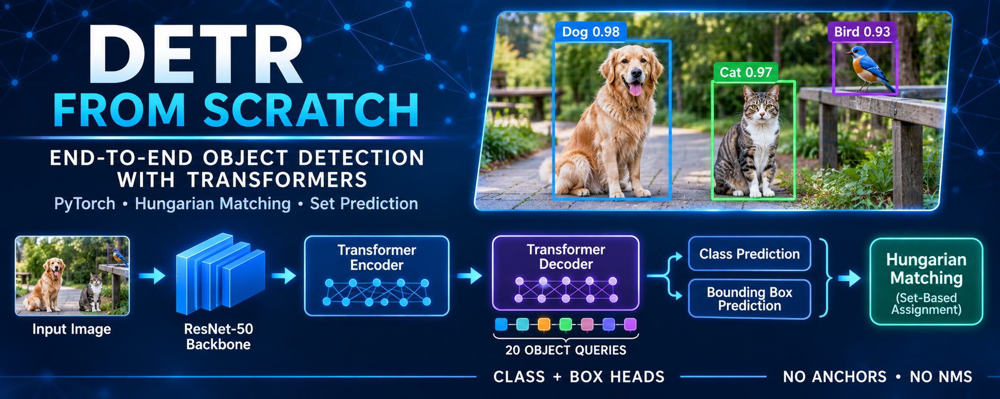
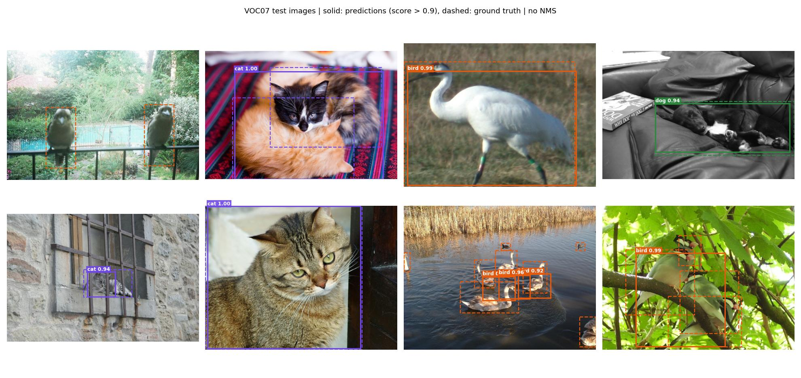
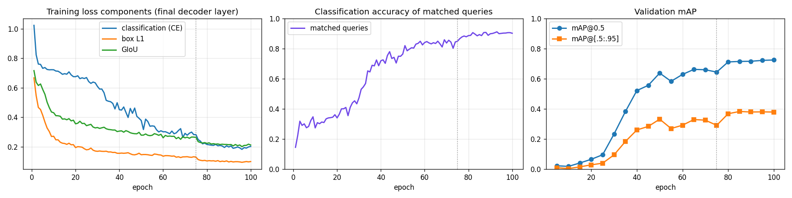
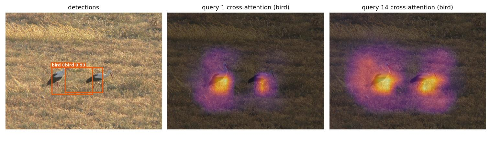
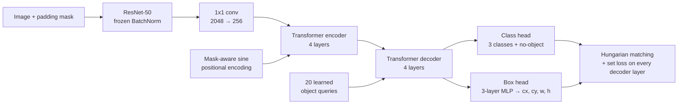

<p align="center">
  
</p>

A from-scratch PyTorch implementation of **DETR** ([Carion et al., *End-to-End Object Detection with Transformers*, ECCV 2020](https://arxiv.org/abs/2005.12872)), trained end to end on Pascal VOC on a single laptop GPU.

Every detection component is written from first principles: the transformer, mask-aware positional encoding, Hungarian matcher, set-prediction loss with auxiliary decoding losses, box-aware augmentation, and a VOC/COCO-style mAP evaluator. The only pre-trained component is the ImageNet ResNet-50 backbone, the same setup as the paper. There are no anchors and no NMS.

<p align="center">
  
</p>

## Results

Trained on the bird / cat / dog subset of **Pascal VOC 2007** (650 training images) for 100 epochs: 69 minutes on one RTX 4070 Laptop GPU (8 GB). Evaluated on the VOC07 **test** split (750 images), using the checkpoint selected on a held-out validation split.

| Class | AP@0.5 | AP@[.5:.95] |
|:------|-------:|------------:|
| bird  | 0.471  | 0.214 |
| cat   | 0.855  | 0.513 |
| dog   | 0.850  | 0.487 |
| **mean** | **0.725** | **0.405** |

Two independent training runs gave a test mAP@0.5 of 0.725 and 0.735.

<p align="center">
  
</p>

**DETR's slow start is visible above.** Box regression improves from the first epoch, but classification of matched queries stays near chance for about 30 epochs while several queries compete for the same object and the Hungarian assignment keeps changing. Once the decoder's self-attention learns to assign one query per object, accuracy and mAP rise sharply. This plateau is the convergence problem that Deformable DETR, DAB-DETR and DINO were designed to fix.

<p align="center">
  
</p>

Cross-attention of the last decoder layer for the two detected storks. Each query concentrates on the object it predicts.

## Architecture



| Component | Implementation |
|-----------|----------------|
| Backbone | ResNet-50, ImageNet weights, `FrozenBatchNorm2d`; stem and `layer1` frozen, `layer2-4` fine-tuned at 0.1× LR |
| Positional encoding | 2D sine/cosine from a cumulative sum over **unpadded** cells, so the encoding is independent of batch padding |
| Transformer | Post-norm encoder-decoder (d=256, 8 heads, FFN 1024), `key_padding_mask` in self- and cross-attention |
| Matching | Batched cost matrix `1·(−p_class) + 5·L1 + 2·(−GIoU)` on GPU; `scipy` Hungarian solver per image |
| Loss | Weighted CE (no-object weight 0.1) + L1 + GIoU, normalised by the number of boxes and applied to **all** decoder layers |
| Data | Box-consistent flip, multi-scale resize, random crop and colour jitter; padded batching with masks |
| Training | AdamW, linear warmup, step decay, gradient clipping (0.1), bf16 autocast, resumable checkpoints |
| Evaluation | VOC protocol (all-point AP, "difficult" objects ignored) at IoU 0.5 and COCO-style IoU 0.50:0.95 |

## Quick start

```bash
git clone https://github.com/<user>/DETR-from-scratch.git
cd DETR-from-scratch
pip install -e ".[dev]"        # install a CUDA build of PyTorch first if you want GPU training
```

**Train.** VOC 2007 (~900 MB) is downloaded on first use to `data.root`.

```bash
python scripts/train.py --config configs/voc_bird_cat_dog.yaml
# any config value can be overridden from the command line
python scripts/train.py --config configs/voc_bird_cat_dog.yaml train.epochs=50 data.classes=[cat,dog]
```

Training resumes automatically from `runs/<name>/last.pt`. `best.pt` holds the checkpoint with the best validation mAP@0.5.

**Evaluate**

```bash
python scripts/evaluate.py --config configs/voc_bird_cat_dog.yaml --checkpoint runs/voc_bird_cat_dog/best.pt
```

**Predict on your own images**

```bash
python scripts/predict.py --config configs/voc_bird_cat_dog.yaml --checkpoint runs/voc_bird_cat_dog/best.pt \
    --input path/to/images --output-dir predictions --threshold 0.9
```

**Reproduce the figures in this README**

```bash
python scripts/make_figures.py --config configs/voc_bird_cat_dog.yaml \
    --checkpoint runs/voc_bird_cat_dog/best.pt --history runs/voc_bird_cat_dog/last.pt
```

## Project structure

```
detr/
├── config.py               typed dataclass config, YAML + CLI overrides
├── box_ops.py              box conversions, IoU, GIoU
├── matcher.py              batched Hungarian matcher
├── losses.py               set criterion with auxiliary decoding losses
├── evaluation.py           VOC / COCO-style mAP
├── engine.py               train / eval loops, post-processing
├── visualize.py            detections, attention maps, curves
├── data/
│   ├── voc.py              VOC download, parsing, class-subset filtering, splits
│   └── transforms.py       box-aware augmentations
└── models/
    ├── backbone.py         ResNet + FrozenBatchNorm + mask downsampling
    ├── position_encoding.py
    ├── transformer.py
    └── detr.py
scripts/                    train · evaluate · predict · make_figures
configs/                    experiment configs
tests/                      unit tests (CPU, no downloads)
```

## Design notes

- **Class-subset filtering.** An image is used only if *all* its objects belong to the selected classes. Keeping an image with a dog *and* a person while labelling only the dog would teach the model that people are background.
- **Splits.** Validation is held out from VOC07 `trainval` by image id and is used for checkpoint selection. The official VOC07 `test` split is used only for the final numbers.
- **Mixed precision.** The model runs under bf16 autocast, but matching and all loss terms are computed in float32. Hungarian assignment and GIoU are sensitive to rounding.
- **No NMS.** Every query outputs one prediction, and each ground-truth object is matched to exactly one query during training. Duplicates are therefore penalised by the loss instead of removed by post-processing.

## Testing

```bash
pytest -q          # 24 tests, ~10 s on CPU
ruff check .
```

The tests cover box ops against `torchvision.ops`, matcher and loss on known assignments, hand-checked AP cases (duplicates, false positives ranked first, *difficult* objects), box-consistency of every augmentation, padding-mask invariance of the transformer and positional encoding, and config overrides. CI runs them on every push.

## Limitations and next steps

- **Small and crowded objects** (bird AP 0.47) suffer from the single stride-32 feature map and the 20-query budget. Multi-scale deformable attention (Deformable DETR) is the natural next step.
- **Convergence**: the about-30-epoch plateau could be shortened with denoising queries (DN-DETR / DINO) or anchor-box queries (DAB-DETR).
- **Data**: 650 training images is very little for a transformer detector; VOC07+12 or COCO would improve results further.

## References

- N. Carion, F. Massa, G. Synnaeve, N. Usunier, A. Kirillov, S. Zagoruyko. [End-to-End Object Detection with Transformers](https://arxiv.org/abs/2005.12872). ECCV 2020.
- H. Rezatofighi et al. [Generalized Intersection over Union](https://arxiv.org/abs/1902.09630). CVPR 2019.
- M. Everingham et al. [The PASCAL Visual Object Classes (VOC) Challenge](http://host.robots.ox.ac.uk/pascal/VOC/). IJCV 2010.

## License

[MIT](LICENSE)
